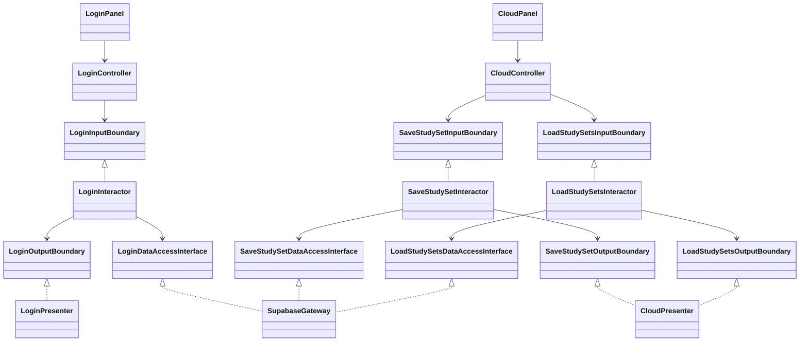
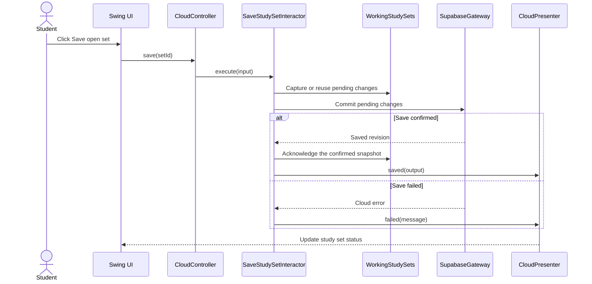

# Flashcards

## Team Information

### Team Members
- Wes
- Ryan
- Elia
- Olivia
- Abel
  
---
## Project Description

### Domain

The Flashcards application turns course materials into practice quizzes and flashcards to help students study. Students may upload notes and chooses what to practice, and the application creates flashcards based off the notes. The user can move and copy existing flashcards into another, new or already existing group of flashcards. Users' tests can be saved on an account which saves the previously created study materials to a cloud Users can also create multiple sets of study materials on each account.

---
## User Stories

### User Story 1: As a student, I want to be able to create flashcards, so that I can build a set of study material tailored to my courses.

### User Story 2: As a student, I want to upload lecture notes and have flashcards made for me, to make studying more efficient.

### User Story 3: As a student, I want to be able to edit my existing practice flashcards, so that I can keep them up to date and accurate.

### User Story 4: As a student, I want to be able to create multiple sets of study materials, so that I can study different subjects at the same time.

### User Story 5: As a student, I want to log in to my account, so that I can access my own study sets.

### User Story 6: As a student, I want to save and reopen my study sets, so that I can return to them in later sessions.

### User Story 7: As a student, I want to be able to go through and practice with my study set, so that I can review my course material.

### User Story 8: As a student, I want to be able to edit and delete my old practice sets, so that I can keep my materials organized. 

---
## Use Cases

### Use Case 1: Add Flashcard to Study Set

**Name:** Add Flashcard to Study Set

**Primary actor:** Student (User)

**Preconditions:**
- The user has at least one existing study set.

**Trigger:** The user selects "Add Flashcard" within a study set.

**Main success scenario:**
1. The user opens an existing study set.
2. The user selects "Add Flashcard".
3. The system displays a form with a question field and an answer field.
4. The user enters a question and an answer, and confirms.
5. The system validates that neither field is empty.
6. The system creates the flashcard and adds it to the study set's cards list.
7. The system displays the updated study set, including the new flashcard.

**Extensions:**
- 5a. The question or answer field is empty: the system shows an error message and asks the user to fill in the missing field (return to step 4).
- 4a. The user cancels: no flashcard is created and the study set is unchanged.
- 7a. The user wants to add more flashcards: the user selects "Add Flashcard" again (return to step 2).

**Success outcome:** The new flashcard is part of the chosen study set, and the study set's other flashcards are unchanged.

---

### Use Case 2: Generate Flashcards from Lecture Notes

**Name:** Generate Flashcards from Lecture Notes

**Primary actor:** Student (User)

**Preconditions:**
- The user has a text-based copy of their lecture notes to upload.
- The AI API (OpenAI/Gemini) is reachable.

**Trigger:** The user selects "Upload Notes" and chooses a file.

**Main success scenario:**
1. The user selects "Upload Notes" and chooses a file containing lecture notes.
2. The system reads the text from the file.
3. The system sends the text to the AI API and requests question and answer pairs.
4. The AI API returns the generated question and answer pairs.
5. The system creates a flashcard for each pair and displays them to the user for review.
6. The user accepts the generated flashcards into a study set.

**Extensions:**
- 2a. The file is empty, unreadable, or in an unsupported format: the system shows an error message and asks the user to upload a different file.
- 4a. The AI API fails or times out: the system shows an error message and lets the user retry or create flashcards manually.
- 5a. The generated flashcards are inaccurate: the user can edit or delete them before accepting (see Use Case 3).

**Success outcome:** Flashcards based on the uploaded notes are created and added to the user's chosen study set.

---

### Use Case 3: Edit Flashcard

**Name:** Edit Flashcard

**Primary actor:** Student (User)

**Preconditions:**
- The user has a study set containing at least one flashcard.

**Trigger:** The user selects the "Edit" option on an existing flashcard.

**Main success scenario:**
1. The user opens a study set, selects "View Flashcards", chooses a flashcard, and selects "Edit".
2. The system displays the flashcard's current question and answer in editable fields.
3. The user changes the question, the answer, or both.
4. The user confirms the changes.
5. The system validates that neither field is empty.
6. The system updates the flashcard and returns to the study set with a confirmation message. The updated flashcard appears in "View Flashcards".

**Extensions:**
- 5a. A field is empty: the system shows an error message and asks the user to fix it (return to step 3).
- 4a. The user cancels: the system discards the changes and the flashcard stays as it was.
- 3a. The user chooses to delete the flashcard instead ("Delete" on the edit form): the system asks for confirmation, then removes it from the study set and returns to the study set with a confirmation message. If the user does not confirm, the flashcard is kept and the edit form stays open.
- 3b. The user chooses to change the order of the flashcards instead ("Move Up" / "Move Down" in "View Flashcards"): the system moves the selected flashcard one place, shows the new order with the moved flashcard still selected, and keeps that order for later review. The user can repeat this until the flashcards are in the order they want.

**Success outcome:** The flashcard in the study set reflects the user's edits, including any change to its position in the study set.

---

### Use Case 4: Create Study Set

**Name:** Create Study Set

**Primary actor:** Student (User)

**Preconditions:**
- The user is logged in to their account.

**Trigger:** The user selects "New Study Set".

**Main success scenario:**
1. The user selects "New Study Set".
2. The system prompts the user for a name for the study set (for example, a course or subject).
3. The user enters a name and confirms.
4. The system validates that the name is not empty and not already used by another of the user's study sets.
5. The system creates an empty study set and adds it to the user's list of study sets.
6. The system opens the new study set so the user can start adding flashcards.

**Extensions:**
- 4a. The name is empty: the system shows an error message and asks for a name (return to step 3).
- 4b. The user already has a study set with that name: the system asks the user to choose a different name (return to step 3).
- 3a. The user cancels: no study set is created.
- 6a. The user wants another study set for a different subject: the user returns to their list and selects "New Study Set" again (return to step 1). Each study set is kept separate from the others.

**Success outcome:** A new, empty study set opens as a local draft, ready for the user to add flashcards.

---

### Use Case 5: Login

**Name:** Login

**Primary actor:** Student (User)

**Preconditions:**
- The user has an account with a confirmed email address.

**Trigger:** The user selects "Log in / Reauthenticate".

**Main success scenario:**
1. The user enters their email and password and selects "Log in / Reauthenticate".
2. The system validates the email and password input.
3. The system verifies the credentials and signs the user in.
4. The system confirms the login and enables the account's study set features.

**Extensions:**
- 1a. The user needs an account: the user selects "Sign up", confirms their email, and returns to step 1.
- 2a. A field is missing or the email is invalid: the system asks the user to correct the input (return to step 1).
- 3a. The credentials are incorrect or the email is unconfirmed: the system shows an error and lets the user try again (return to step 1).

**Success outcome:** The user is signed in and can access their account's study features.

---

### Use Case 6: Save and Load Study Sets

**Name:** Save and Load Study Sets

**Primary actor:** Student (User)

**Preconditions:**
- The user is logged in (see Use Case 5).
- The user has an open study set with unsaved changes.

**Trigger:** The user selects "Save open set" or opens a saved study set from the list.

**Main success scenario:**
1. The user selects "Save open set". Changes stay local until this step.
2. The system saves the set's name, flashcard changes, and card order to the user's account. Saving changes to an existing set updates the same set.
3. The system confirms the save.
4. In a later session, the user logs in and the system lists their saved study sets.
5. The user selects the saved study set.
6. The system opens it with its saved name, questions, answers, and card order.

**Extensions:**
- 1a. The user only wants to open a previously saved set: the user selects it from the list (continue at step 6).
- 2a. The save fails: the system shows an error, keeps the unsaved changes locally, and lets the user retry (return to step 1).
- 4a. The list fails to load: the system shows an error and lets the user select "Refresh set list" to retry.
- 6a. A local working copy already exists: the system opens that copy with any unsaved changes intact.
- 6b. The study set fails to load: the system shows an error, keeps existing local drafts, and lets the user try again (return to step 5).

**Success outcome:** The study set and its flashcards are stored in the cloud under the user's account and can be retrieved in later sessions.

---

### Use Case 7: Practice Study Set

**Name:** Practice Study Set

**Primary actor:** Student (User)

**Preconditions:**
- The user has a study set containing at least one flashcard.

**Trigger:** The user selects "Study" on a study set.

**Main success scenario:**
1. The user opens a study set and selects "Study".
2. The system displays the first flashcard with only the question visible.
3. The user tries to recall the answer and selects "Flip".
4. The system reveals the answer.
5. The user marks the flashcard as "Got it" or "Still learning".
6. The system records the result and displays the next flashcard.
7. The user repeats steps 3 to 6 until every flashcard has been reviewed.
8. The system displays a summary showing how many flashcards were marked "Got it" and how many "Still learning".

**Extensions:**
- 2a. The study set has no flashcards: the system shows a message and offers to add flashcards (see Use Case 1).
- 2b. The user chooses to shuffle: the system randomizes the order of the flashcards before starting.
- 6a. The user selects "Previous": the system displays the previous flashcard.
- 7a. The user ends the session early: the system displays a summary of the flashcards reviewed so far.
- 8a. The user selects "Practice missed cards": the system starts a new session with only the "Still learning" flashcards (return to step 2).

**Success outcome:** The user has gone through the flashcards in the study set and can see which ones they know and which they still need to review.

---
### Use Case 8: Edit Study Set

**Name:** Edit Study Set

**Primary actor:** Student (User)

**Preconditions:**
- The user has at least one study set.

**Trigger:** The user selects "Edit" on a study set.

**Main success scenario:**
1. The user selects a study set and presses "Edit".
2. The system displays the available editing options: delete the study set, edit its name, or move its position up or down in the list.
3. The user selects an editing option.
4. The system performs the selected action.
5. The system displays the updated list of study sets.

**Extensions:**
- 2a. The user chooses to delete the study set: the system asks the user to confirm the deletion.
- 2b. The user chooses to move the set up or down: the system will not allow the user to move the set down if it is already at the bottom, or move it up if it already at the top.
- 4a. The user chooses to edit the name: the system will reject the new name if the name is invalid.

**Success outcome:** The study set is deleted, renamed or moved, and the updated list is shown
---
## Minimal Viable Product (MVP)

| Team Member | MVP Use Case |
|-------------|--------------|
| Wes | Create a Set of Flashcards |
| Ryan | Generate Flashcards from Lecture Notes |
| Elia | Edit Flashcard |
| Olivia | Create Multiple Sets of Flashcards |
| Abel | Login |
| Abel | Save and Load Study Sets |
| Wes | Practice Study Set |
| Olivia | Edit Study Set |

---
## Entities

### Flashcard

Stable UUID `id` and immutable `question` and `answer`. The getters expose these fields. The existing two-argument constructor creates an ID; the three-argument constructor rebuilds the same card from storage.

### StudySet

Stable UUID `id`, a `name`, and a `CardsList`. The getters expose the local working copy. `StudySetFactory.create` creates a new empty set.

### CardsList

Ordered flashcards with `addCard`, `removeCard`, `replaceCard`, `getCards`, and `size`. Replacing card text preserves its identity. Local changes are compared with the last acknowledged snapshot when Save is clicked.

### User

Authenticated UUID `id` and `email`. The `getId` and `getEmail` methods expose the account identity.

---

## API Usage

- **Gemini** generates questions and answers from uploaded notes. [Gemini API docs](https://ai.google.dev/gemini-api/docs/text-generation). Generation and blocked-response handling were tested with fixtures. A live PDF upload is still to be confirmed. [PDF upload PR](https://github.com/Tabel0112/team-project/pull/11)
- **Supabase Auth** handles signup and login. A live Java check verified login with a confirmed account. [Supabase Auth docs](https://supabase.com/docs/guides/auth)
- **Supabase Data API** stores and loads study sets. A live Java check saved a set and reopened it from a fresh process. [Supabase API docs](https://supabase.com/docs/guides/api) · [Verification details](database/README.md)

---
## Design Diagrams

### UML Class Diagram

Login and Save/Load depend on interfaces declared by their use cases. `AppBuilder` connects them to Swing and the Supabase adapter.



### Sequence Diagrams



---
## How to Run

Requires Java 11+ and Maven. From the project directory:

```sh
mvn compile exec:java "-Dexec.mainClass=app.Main"
```

### Supabase setup

Follow the [Supabase setup guide](database/README.md) to install the schema on a new project.

Set these environment variables or add them to the ignored `.env` file in the project directory:

```dotenv
SUPABASE_URL=https://<project-reference>.supabase.co
SUPABASE_ANON_KEY=<publishable-key-or-legacy-anon-key>
```

### Login and manual Save

Log in with a confirmed account, or sign up and confirm your email first. Changes stay local until you click **Save open set**. Saved sets appear in your list when you log in again. If Save fails, you can retry with your changes intact. The app asks for confirmation before discarding unsaved study changes when you log out or close it.

### Validation

```sh
mvn test
```

Live Supabase login, save, and reopen checks passed. The [verification guide](database/README.md) records the results and the pending Swing walkthrough.
